# Marketplace Funnel & Retention Analytics

**What drives repeat purchases and trust in a two-sided social-commerce marketplace?** This project covers the buyer funnel, buyer and seller retention, and a root-cause dive into delivery reliability, reviews and repeat purchase. It uses ~99k real marketplace orders, and all the SQL runs in DuckDB.

> Disclaimer: this is an independent portfolio project built on public data (Olist). It is not affiliated with or endorsed by Meta.

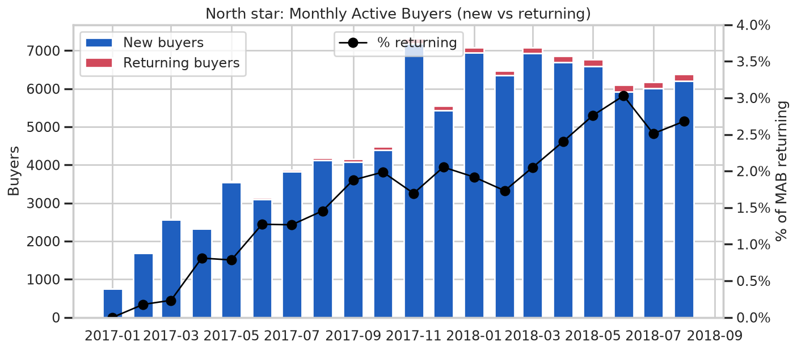

---

## 1. Problem

A marketplace only compounds if **buyers come back** and **sellers keep listing**. Trust is the connection between the two: buyers return when the item arrives as promised and the seller is reliable. This analysis answers four product questions:

1. Where does the buyer journey leak, from checkout to delivery to a satisfied buyer, and for which segments?
2. How well do buyer and seller cohorts retain, and what is a buyer worth over time?
3. Why is the repeat-purchase rate so low, and what moved the trust metric (review score) in early 2018?
4. Which three product bets would move the north star most?

## Why this matters for a marketplace like Facebook Marketplace

- **Peer-to-peer and small-business commerce runs on trust.** Olist connects many small Brazilian sellers to buyers, the same shape as Marketplace and Shops. Late or missing items quickly erode buyer confidence and future demand.
- **Both sides have to retain.** Buyer liquidity attracts sellers, and seller supply and reliability bring buyers back. The data shows a large asymmetry between the two sides (sellers retain ~120x better month over month), which tells you where to invest.
- **Ratings are the trust signal.** On social-commerce surfaces, ratings and reviews shape ranking and buyer confidence. Here, missing a delivery promise is the single biggest driver of bad reviews.
- **The methods carry over directly.** A north-star metric tree, segmented funnels, cohort retention, stickiness, and mix-vs-rate decomposition of a metric move are the core toolkit for product analytics on marketplace surfaces.

## 2. Data

- **Source:** [Brazilian E-Commerce Public Dataset by Olist](https://github.com/olist/work-at-olist-data). This is Olist's official GitHub repo, and the same data is published on Kaggle under **CC BY-NC-SA 4.0**. Credit: Olist.
- **Coverage:** orders, customers, items, sellers, payments, reviews and products. Purchases from **2017-01-01 to 2018-08-31** are used (20 complete months). 2016 and Sep–Oct 2018 hold only a few hundred orders and are excluded.
- **Scale in window:** 99,092 orders placed, 97,905 purchases, **94,703 unique buyers**, R$15.69M GMV, 3,029 active sellers.
- Raw files are **not committed** (several are >5 MB). `src/download_data.py` fetches them without a login.

## 3. Metric definitions (summary)

The full definitions and metric tree are in [`docs/metric_definitions.md`](docs/metric_definitions.md).

| Metric | Definition |
|---|---|
| **North star: Monthly Active Buyers (MAB)** | Distinct buyers (`customer_unique_id`) with >= 1 purchase in the month |
| Repeat buyer rate | Buyers with >= 2 purchases / all buyers |
| AOV | GMV (item price + freight) / purchases |
| Funnel completion | Orders delivered on time **and** rated >= 4 / orders placed |
| On-time rate | Delivered on or before the promised date / delivered |
| Buyer / seller cohort retention | % of a first-transaction-month cohort transacting again in month k |
| Cumulative GMV per buyer | Cohort GMV through month k / cohort size (LTV-style) |
| DAU/MAU, WAU/MAU | Purchase-based stickiness (trailing 1/7/28-day distinct buyers) |

## 4. Method

```
src/download_data.py   -> data/raw/*.csv            (official Olist repo, no login)
sql/00_views.sql       -> DuckDB model: orders, purchases, seller_orders fact tables
sql/01-14_*.sql        -> executed by src/run_sql.py -> outputs/*.csv
src/analysis.py        -> figures/*.png + outputs/findings.json (every number below)
```

Techniques: a north-star metric tree, an order-to-satisfaction funnel with step drop-off, segmentation (region, payment type, category), monthly cohort retention heatmaps for buyers and sellers, LTV-style cumulative revenue curves, DAU/WAU/MAU stickiness, **shift-share (mix vs rate) decomposition** of a metric movement, and a two-proportion z-test.

## 5. Key findings (real outputs)

### Headline numbers
| | |
|---|---|
| Unique buyers | **94,703** |
| Repeat buyer rate | **3.03%** (2.17% if same-day split baskets are excluded) |
| GMV share from repeat buyers | **5.65%** |
| AOV | **R$160.24** |
| Late deliveries | **6.79%** of delivered orders |
| Avg review | **4.12 / 5** |

### Finding 1: The funnel leaks at trust, not logistics
97.1% of orders are delivered, but only **74.4%** end up on time with a positive review. The two largest drops are *delivered -> on time* (-6.8%) and *on time -> review >= 4* (-17.8%).

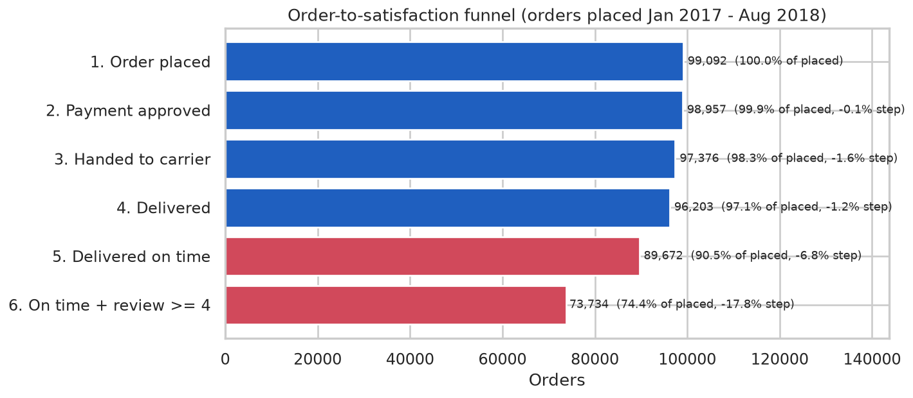

By region, the **Northeast** has **12.8%** late deliveries against 6.1% in the Southeast, an average **19.9 days** to deliver against 10.7, and the lowest funnel completion (**68.0%** against 75.5%).

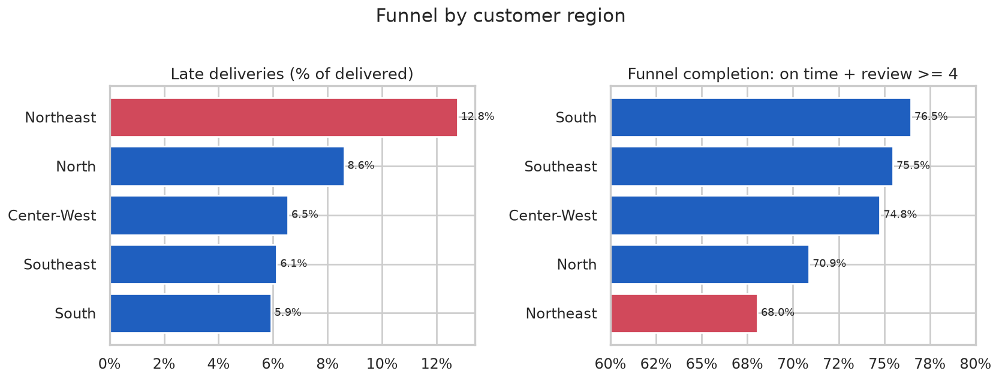

### Finding 2: Buyers don't come back, but sellers do
Size-weighted buyer cohort retention is **0.48% in month 1, 0.23% in month 6 and 0.18% in month 12**. Seller cohorts retain at **58.8% / 45.3% / 37.1%**. Supply is sticky and demand is close to single-use. MAB grew from 753 to 6,380 almost entirely on **new** buyers (returning buyers were 2.37% of MAB in 2018).

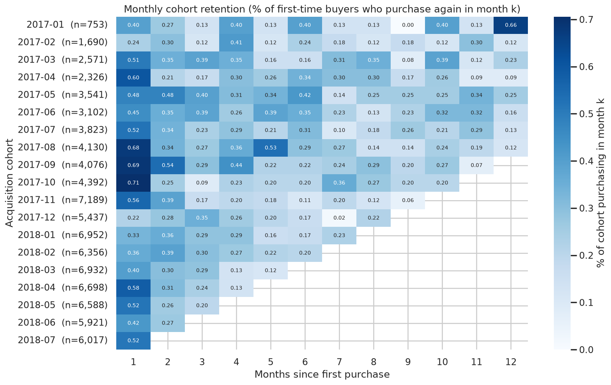
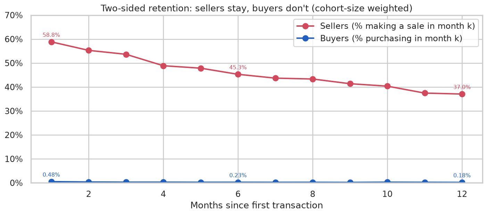

Cumulative GMV per buyer grows only **+3.0%** from month 0 to month 12 (R$164.71 to R$169.58, averaged over the 8 cohorts with 12 observed months). LTV is essentially the first basket.

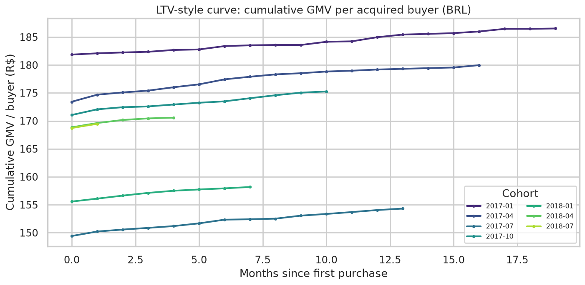

Purchase stickiness in 2018: **DAU/MAU 3.6%, WAU/MAU 25.3%** (avg DAU 219, 28-day MAU 6,105). The peak day was Black Friday 2017-11-24 with 1,151 buyers.

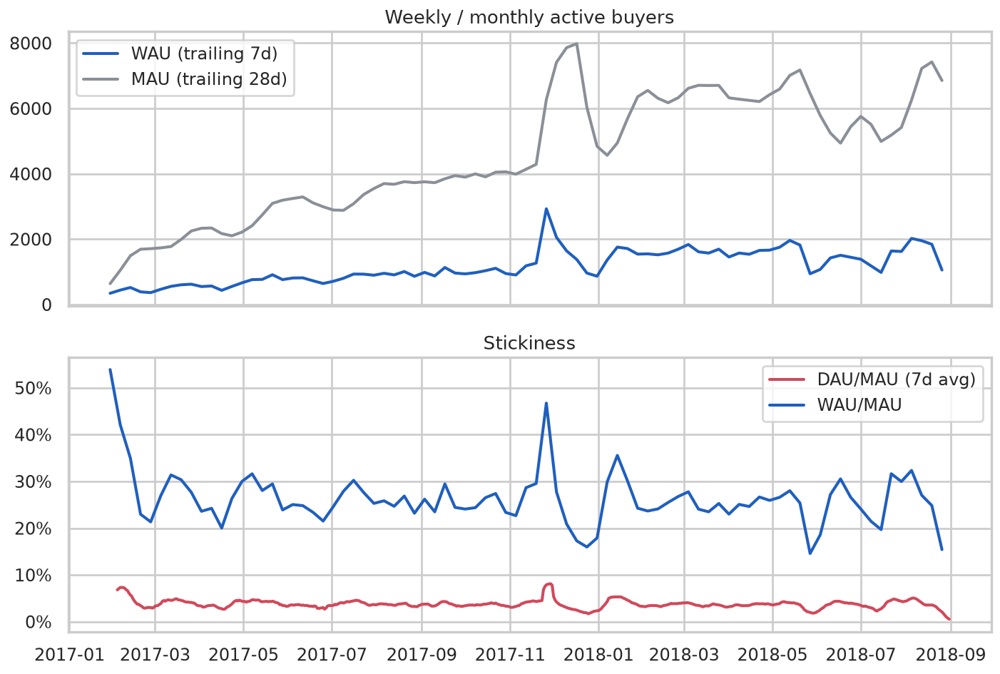

### Finding 3: Missing the delivery promise wrecks the trust signal
Orders delivered >= 14 days early average **4.33** stars (6.5% 1-star). At 1–3 days late the average drops to **3.29** (25% 1-star), and at 4–7 days late to **2.10** (59% 1-star).

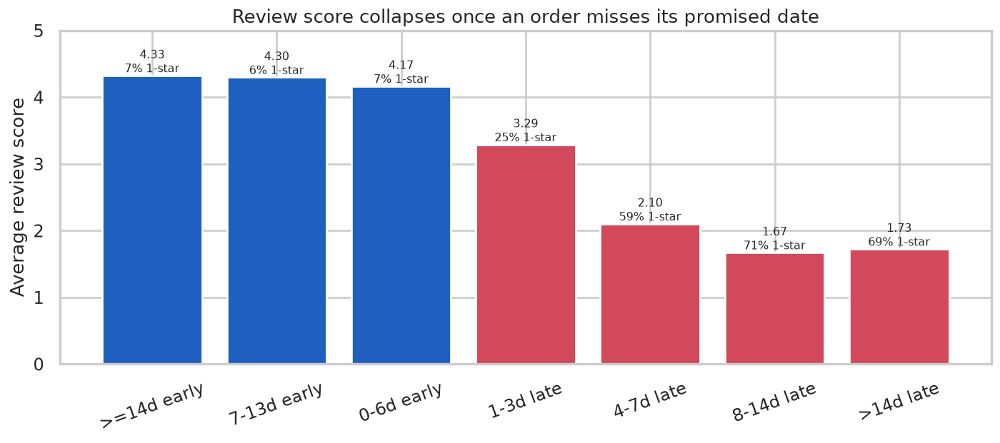

### Finding 4 (metric-movement deep dive): Why did review score fall in Feb–Mar 2018?
Avg review fell from **4.11 (Jan-18) to 3.81 (Mar-18)**, a drop of 0.30. Over the same months, late deliveries jumped from **5.7% to 18.7%**, and the promised delivery window was *shortened* (26.9 to 22.7 days) while actual delivery got *slower* (14.0 to 16.2 days). A shift-share decomposition attributes **-0.284 of the -0.296 drop (96%) to mix**, meaning more orders landed in the late bucket. On-time orders were rated almost the same (4.23 vs 4.21). The fix is delivery reliability. Seller quality or product mix did not drive it.

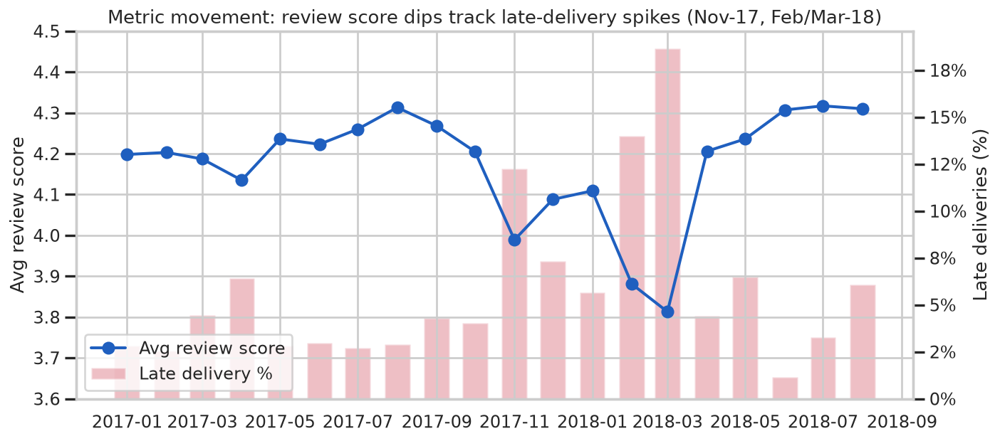

### Finding 5: Why is repeat rate low?
Among first orders from Jan-17 to Feb-18 (each with >= 6 months to repurchase), buyers whose first order arrived **late repeat at 3.16%**, against **4.08%** when it arrived on time. That is **-22.5% relative** (two-proportion z = 2.74, p = 0.006; n = 3,671 late vs 51,562 on time). A 5-star first order repeats at 4.26% against 3.84% for 1-star. Even so, every bucket sits below 4.5%, so late delivery explains part of the gap. The low baseline points to **no re-engagement loop** after the first purchase. Also, 30% of all second purchases happen on the **same day** as the first (split baskets), so true return behaviour is weaker than 3%.

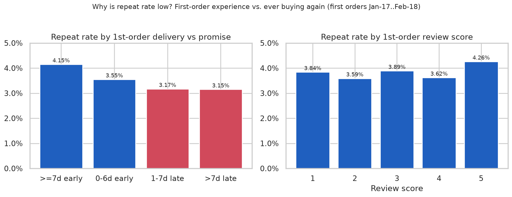

### Finding 6: Seller health
Among 966 sellers with >= 5 orders in their first 90 days, **88.8%** were still selling in days 91–180. Retention climbs with early volume, from **81.3%** (5–9 orders) to **98.4%** (25–49 orders). It also dips for poorly rated sellers: **79.5%** for those averaging < 3.5 stars, against 92.3% for 4.0–4.5. Supply is concentrated: the top 10% of sellers earn **55.5%** of seller revenue in an average month. *(Correlational. Early late-rate does not show a clean pattern, likely because it is confounded with volume.)*

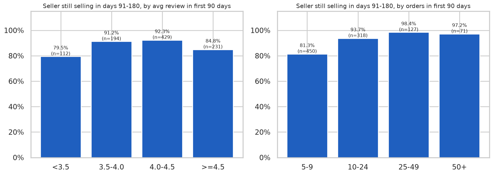

## 6. Recommendations (with expected-impact framing)

1. **Reliable delivery promises plus late-risk interventions (trust).** Set promise dates from region- and seller-level history, starting in the Northeast and North. Flag at-risk orders early and send proactive updates.
   *Expected impact:* bringing Northeast funnel completion up to the Southeast level adds about **690 more on-time, positively rated orders** over the window (9,359 orders x 7.4 pp). In surge months like Mar-18, keeping the late share near 5–6% would have protected about **0.28 review points**, since 96% of that dip was mix. *Guardrail:* checkout conversion if ETAs get longer. Validate with a regional A/B test.

2. **Second-purchase activation loop (buyer retention).** Send personalised re-engagement 30–90 days after the first delivery, weighted toward categories with natural repeat (furniture_decor 4.6% and bed_bath_table 4.5% repurchase, against auto 2.1%). Suppress or apologise-plus-credit when the first order was late.
   *Expected impact:* every **+1 pp** of repeat rate is about **947 buyers x R$160 AOV ≈ R$152k GMV (~1.0%)**, assuming one extra order each. Measure with a holdout group.

3. **Seller onboarding to the first 10 orders, plus quality coaching (supply retention).** Give new sellers early visibility boosts until they reach ~10 orders. Coach sellers whose early rating falls below 3.5.
   *Expected impact:* if the 450 sellers who had 5–9 early orders retained like the 10–24 group (93.7% vs 81.3%), about **56 more sellers** stay active per comparable cohort. This is an upper bound because the relationship is correlational. Test with randomised boosts.

## 7. How to run

```bash
git clone https://github.com/kedarnath30/marketplace-funnel-retention.git
cd marketplace-funnel-retention
pip install -r requirements.txt
python src/download_data.py   # ~64 MB from the official Olist GitHub repo, no login
python src/run_sql.py         # executes sql/*.sql in DuckDB -> outputs/*.csv
python src/analysis.py        # figures/*.png + outputs/findings.json
```

## 8. Repo layout

```
sql/        DuckDB SQL: data model (00) + 14 analysis queries
src/        download, SQL runner, analysis & charts
outputs/    query results (CSV) + findings.json
figures/    charts embedded above
docs/       metric definitions & metric tree
```

## Limitations
- There are no session or browse events, so the funnel covers checkout through repurchase, not discovery to cart.
- "Active" means purchased, so stickiness here is not app engagement.
- Driver analyses are observational. The recommendations are framed as experiments to run.

## License
Code is MIT (see `LICENSE`). Data © Olist, CC BY-NC-SA 4.0. It is not redistributed here.
